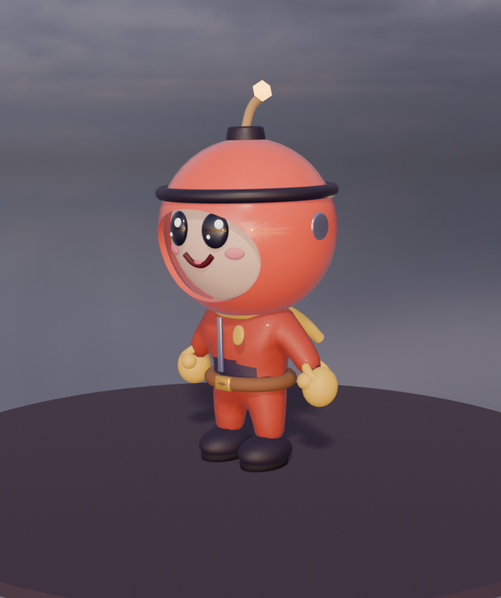

# 4Walls — Design de personagem

## Conceito: "o Aventureiro-Pavio"

Um aventureirinho de cabeça redonda e enorme, bochechas rosadas e olhos grandes e brilhantes,
que usa um **capacete em forma de bomba com pavio aceso**. É a assinatura do jogo, legível
mesmo minúscula na câmera de cima. Personalidade: curioso, destemido e um pouco atrapalhado.

- **Proporção:** a cabeça tem raio 0,28 com centro a 0,86, o que dá ~50% da altura total
  (~1,2 un. com o capacete). Corpo compacto, braços e pernas curtos, luvas e botas grandes.
- **Silhueta:** domo do capacete com pavio, luvas claras e botas escuras. Os três elementos
  sobrevivem a qualquer combinação de peças.
- **Olhos:** ovais pretos brilhantes com dois reflexos (grande e pequeno). As expressões vêm de
  sobrancelha e boca, que é o que se lê de cima.

## Arquitetura modular

Um esqueleto padrão, `4W_Rig`, com 22 ossos: `root`, `hips`, `chest`, `head` e, nos dois lados,
`upper_arm`, `forearm`, `hand`, `thigh`, `shin` e `foot`. Cada peça é um **GLB próprio**,
deformado por esses mesmos ossos. Em tempo de execução, a peça é religada ao esqueleto da base
pelo nome do osso (testado no Ateliê).

| Slot | Osso de fixação | Peças da Fase 1 |
|---|---|---|
| Base (corpo, cabeça, luvas, botas + animações) | — | `adventurer_base` |
| Capacete (`headgear`) | `head` | capacete-bomba clássico, gorro de piloto, chapéu de mago |
| Rosto (`face`) | `head` | feliz, bravo, surpreso |
| Roupa (`clothing`) | casca com pesos automáticos, mais peças rígidas em `chest` / `hips` / `upper_arm` | macacão de bombardeiro, moletom, armadura |
| Costas (`back`) | `chest` | mochila-foguete, mochila-bomba |
| Pescoço (`neck`) | `chest` | cachecol |

**Materiais recoloríveis por nome** (variantes de cor sem duplicar modelos):

| Material | Papel na paleta |
|---|---|
| `Helmet` | cor primária |
| `Glove` | secundária |
| `Accent` | detalhe |
| `Outfit` | roupa |
| `Suit` | segunda pele escura, fixa |

Paletas: rubro, celeste, lima, ametista e sol (`manifests/customization/palettes.json`).

**Animações** (24 fps): `Idle`, `Walk`, `Run`, `PlaceBomb`, `Hit`, `Cast`, `Victory` e `Defeat`.
As poses de vitória usam punhos erguidos e braços abertos em "V": os braços são curtos perto da
cabeça grande e, levantados retos, ficariam escondidos atrás dela.

## Folhas de referência

- Capacetes: `game-assets/previews/characters/sheet_headgear.png`
- Expressões: `sheet_faces.png`
- Roupas: `sheet_clothing.png`
- Costas: `sheet_back.png`
- Paletas e combinações: `sheet_palettes.png`
- Vistas de frente, lado, 3/4 e isométrica: `hero_*.png`

## Próximos passos (Fase 2 de arte)

- **Arquétipos:** Ninja, Engenheiro e Mago montados com este kit, substituindo os modelos atuais do jogo.
- **Mais peças:** 10 capacetes, 6 expressões, 8 roupas e 8 acessórios.
- **Animações:** pulo, aterrissagem, virada e eliminação.
- **Revisão de clipping:** acessórios contra animações extremas (derrota e vitória).
