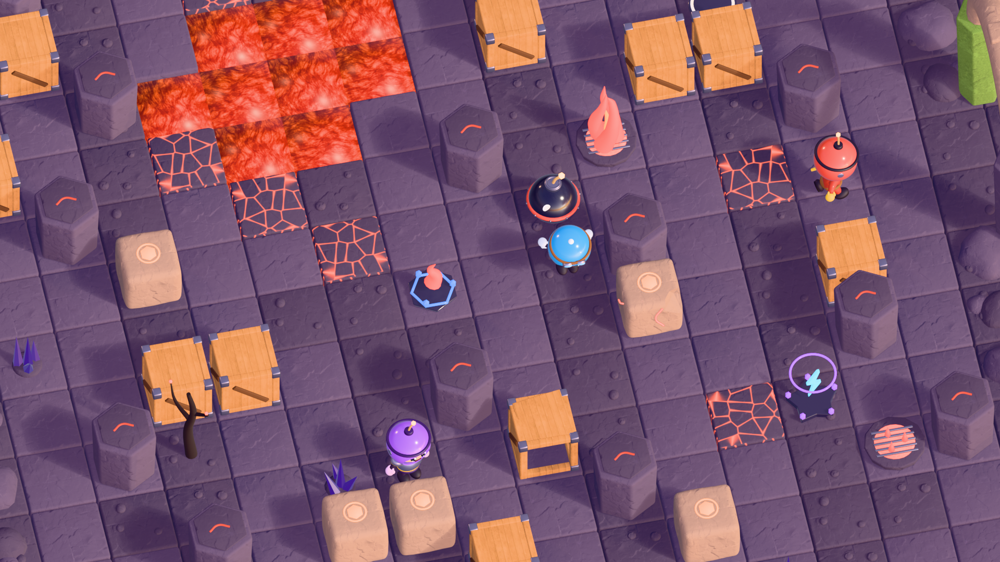

# 4Walls — Design de ambiente

## Princípios

- **Leitura antes de detalhe.** Da câmera elevada a ~57°, cada categoria precisa ser
  reconhecida num relance:

  | Categoria | Visual |
  |---|---|
  | Chão | baixo e escuro |
  | Sólidos | hexágonos escuros e altos |
  | Destrutíveis | caixas quentes (madeira e pedra clara) |
  | Perigos | grelhas com brilho |
  | Coletáveis | pedestais com anel e ícone flutuante |

- **Raridade pela forma, não só pela cor.**

  | Raridade | Base do pedestal |
  |---|---|
  | Comum | círculo |
  | Raro | hexágono com 3 gemas |
  | Épico | estrela com halo e 5 gemas |
  | Lendário (previsto) | coroa com asas |

- **Brilho com moderação.** A emissão marca só o que importa (lava, fogo, runas, faíscas).
  O topo das colunas tem um veio fino, não um farol.
- **Estados visuais.**
  - Destrutíveis: intacto → danificado → fragmentos (peças separadas para animar a destruição).
  - Perigos: desligado, ocioso, alerta e ativo.

## Kit da Fase 1

Folha completa em `game-assets/previews/assets/volcanic_kit_sheet.png`. Os 30 assets, com
triângulos e tamanho, estão em `game-assets/manifests/assets/volcanic_kit.json`. Cada asset tem
a origem no centro do tile e apoia em Z = 0.

## Câmera e luz das prévias

- **Câmera:** ortográfica isométrica (elevação de 45–57°, azimute de −12 a −35°).
- **Luz:** HDRI CC0 de pôr do sol, sol principal quente e preenchimento rosado.
- **Cor:** transformação **Khronos PBR Neutral**, a mesma referência dos visualizadores glTF,
  para o que se vê no Blender bater com o Three.js.
