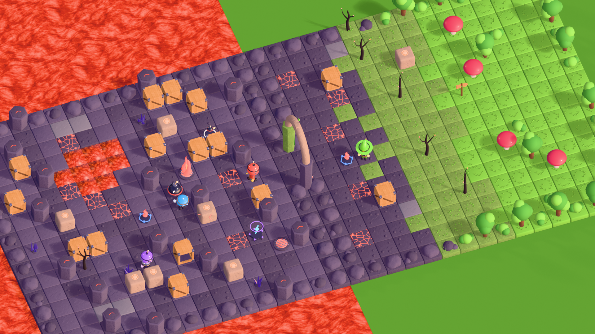

# 4Walls — Design do mundo contínuo

## Visão

O mundo é uma **jornada contínua**, não uma lista de arenas. O jogador atravessa regiões
conectadas. Chefes destravam passagens. Cada bioma muda gradualmente para o próximo, por
**chunks de transição**. A arte fornece peças modulares e metadados; a geração do mundo é
lógica do jogo e fica fora deste pipeline.

## Chunk padrão

| Propriedade | Valor |
|---|---|
| Tamanho | 16 × 16 tiles (1 tile = 1 unidade) |
| Origem | canto sudoeste; o centro da célula `(x, y)` fica em `(x + 0,5, y + 0,5)` |
| Layout | 16 linhas de texto, de norte (y = 15) para sul (y = 0), com legenda (`manifests/world-chunks/*.json`) |
| Chão | um tile por célula; `.` = chão padrão da **região** (o mesmo símbolo serve dos dois lados de uma transição) |
| Bordas naturais | rochas ou vegetação, exceto nas células de conexão |
| Conexões | por lado: células abertas, biomas aceitos do outro lado e o portal (`gate`) usado |
| Montagem | instâncias do kit (malhas compartilhadas). O GLB do chunk serve para prévia e importação, e o JSON é a fonte da verdade. |

Tipos de chunk previstos: exploração, combate, tesouro, enigma, arena de chefe, zona segura,
transição, segredo e evento. Nesta fase existem **exploração** e **transição**.

## Fase 1: dois chunks conectados

1. **`vol_exploration_01`** (Terras Vulcânicas, exploração). Caminho de basalto sinuoso, lago
   de lava, rachaduras incandescentes, grupos de caixotes e blocos de pedra, colunas, um
   respiradouro de fogo ativo e outro em alerta, bomba e power-ups. Saída a **leste** nas
   células (15, 7) e (15, 8).
2. **`trans_vol_forest_01`** (transição Vulcão → Floresta). Entrada a **oeste** nas mesmas
   linhas, pelo **portal** `gate_arch_vol_forest`: pilar de basalto de um lado, pilar com musgo
   e trepadeiras do outro. As colunas 0–4 são vulcânicas, as 5–8 têm musgo e árvores mortas com
   brasas, e a partir da 9 começa a floresta (grama, árvores, cogumelos gigantes e arbustos).
   Saída a leste para `enchanted_forest`.

A regra de conexão é que vizinhos abrem as **mesmas células** no lado compartilhado, e a troca
de bioma sempre passa por um chunk de transição. Veja `manifests/world/world_graph_example.json`.

## Progressão

Cada bioma tem um marco, um chefe (arena dedicada) e uma passagem que só se abre ao derrotá-lo.
Exemplo: o Golem Vulcânico guarda a caldeira; vencê-lo resfria a lava e abre o caminho para a
Floresta Encantada. Biomas e transições planejados estão em `BIOME_DESIGN.md`.

## Protótipo jogável: modo Aventura

Primeira versão jogável do mundo contínuo, em `packages/game-core/src/adventure.ts`:

- **Layout:** as regiões ocupam chunks de 16×14 num passeio aleatório para o leste, sem dois passos verticais seguidos. Todo o resto é vazio (lava), então o mapa não é retangular.
- **Ilhas:** cada região é uma elipse com ruído, com pilares nas células par/par e blocos fora dos corredores e do bolsão de spawn.
- **Portões:** ficam na célula de borda entre duas regiões. São parede até a região de origem ficar sem Magmitos, e então viram piso.
- **Exploração:** a simulação marca como exploradas as células num raio de 4,6 em volta de cada jogador. Isso não aparece na tela, porque a névoa visual foi removida, mas fica disponível para um futuro minimapa.
- **Biomas:** `volcanic` → `transition` → `forest` conforme o índice da região. Mudam as cores do piso, das paredes e dos pilares em `Arena.tsx`.

Próximos passos:
- trocar a geometria procedural pelos kits GLB (`volcanic_kit`);
- minimapa;
- streaming de chunks para mundos sem limite.
